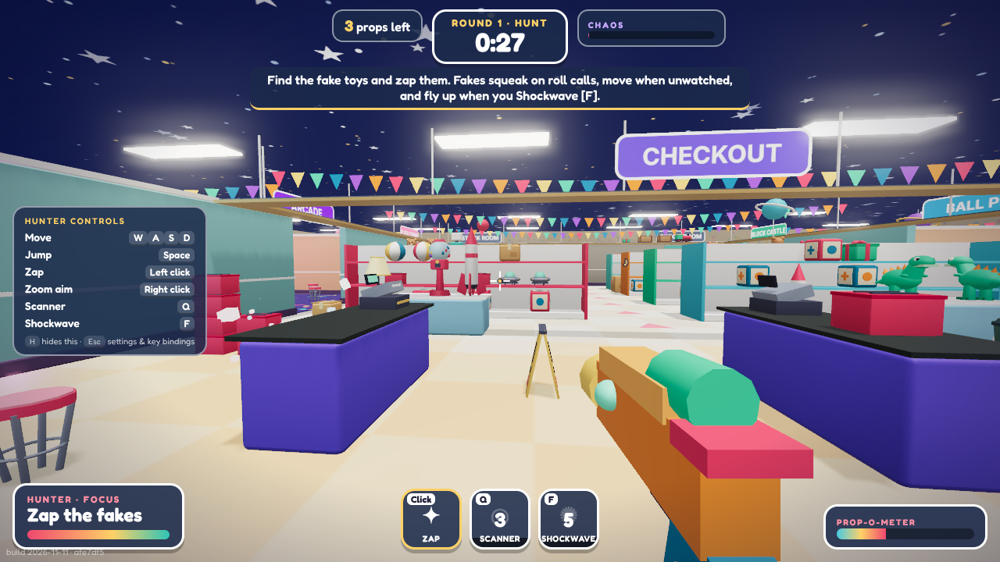
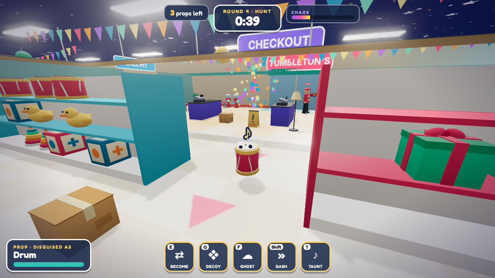
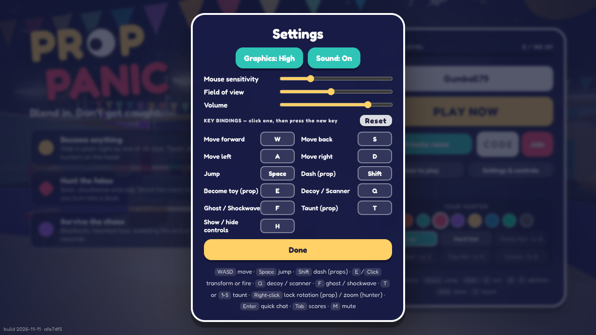

# PROP PANIC

**Blend in. Don't get caught.** A browser multiplayer prop-hunt party game set in a toy store.

Props disguise themselves as toys and hide in plain sight. Hunters have a few minutes to zap every
fake. It runs in any desktop browser, with no install and no downloaded art or audio.



| | |
| --- | --- |
|  |  |

## What makes it different from plain Prop Hunt

| Mechanic | What it does |
| --- | --- |
| **Focus, then QUACK** | Every innocent toy a hunter shoots drains Focus. At zero, the hunter spends 6 seconds as a helpless rubber duck. Spray-and-pray is punished with public humiliation. |
| **Scanner pulse (hunter, Q)** | An expanding ring that only detects props that *move* while it passes. Props see it coming and get a "FREEZE!" warning. |
| **Shockwave (hunter, F)** | Launches real props near the hunter into the air. Innocent toys never flinch. |
| **Decoys (prop, Q)** | Leaves a twitching copy of your disguise. A hunter who shoots it is flash-blinded and loses Focus. Decoys also squeak during roll calls. |
| **Panic burst** | A prop that gets hit is not dead: it gets a short speed boost and one chance to escape. Three hits to catch. |
| **Head bonk** | A prop that drops onto a hunter's head leaves them dizzy and unable to fire for a moment, and bounces away. |
| **Googly eyes** | Whenever a prop taunts, panics, sneezes or is scanned, a pair of googly eyes pops out of it. |
| **Last prop standing** | The final survivor gets Ghost and Decoy recharged; hunters get faster roll calls. |
| **Great escape** | Survive six seconds after being hit and you bank bonus points. |
| **Ghost (prop, F) / Dash (Shift)** | Three seconds of invisibility to hunters; a short sprint. |
| **Risky taunts (T or 1-5)** | Taunting scores more the closer a hunter is, and shortens ability cooldowns. |
| **Chaos meter** | Missed shots, taunts and popped decoys fill it. When full: **Blackout**, **Poltergeist** (toys start hopping), **Prop Shuffle** (everyone becomes a different toy), **Moon Bounce** (low gravity) or **Achoo** (every real prop sneezes into the air). |
| **Roll call** | Every 22 s all props squeak, positioned in 3D audio. |
| **PANIC TIME** | Final 30 s: props squeak every 7 s but move faster. |
| **Restocked every round** | The store's ~250 loose toys are laid out from a new seed each round. |

Roles rotate automatically and the next round starts by itself. Rounds are 25 s hiding + 3 min hunting.

## Run it

```bash
npm install
npm run dev        # server on :8080 + Vite client on http://localhost:5173
```

Production (one process serves the client and hosts every room):

```bash
npm run build
npm start          # http://localhost:8080
```

Or with Docker: `docker build -t prop-panic . && docker run -p 8080:8080 prop-panic`.
Any host that runs a Node container and allows WebSockets works. Set `PORT` if needed.

## Playing with friends

- **Play now** drops you into a public room. Empty seats are filled with clearly labelled bots, and
  humans replace them as they join. You can join mid-round.
- **Create private room** gives a 4-letter code and an invite link (`?room=CODE`). The host can add
  bots and starts the round.
- Refreshing the page or a short network drop puts you back in your seat.

## Progression and looks

Points earned each round become XP (stored in the browser). Levels unlock hunter hats; vest colour is
free to choose. Both are cosmetic only and visible to everyone in the match.

## Controls

Every key can be rebound under **Settings & controls** (main menu, or `Esc` in game), alongside mouse
sensitivity, field of view, volume and graphics quality. Defaults:

`WASD` move · `Space` jump · mouse look · `Click`/`E` become a toy (prop) or fire (hunter) · `Q` `F` abilities ·
`Shift` dash · `T` / `1-5` taunt · right-click holds a prop's rotation or zooms a hunter's aim · scroll zooms ·
`H` controls card · `Enter` quick chat · `Tab` scores · `M` mute.

New players get a "How to play" guide on first visit, an objective line at the top of the screen and
a controls card for their current role.



## Deploying

`render.yaml` is a Render blueprint (free plan, Docker). The menu shows a build stamp in the bottom-left
corner (date and commit), so you can check which version a server is actually running.

## How it is built

```
shared/   deterministic map generator, AABB character physics, prop catalog, protocol
server/   Node + ws: rooms, matchmaking, round flow, hit detection, abilities, bots
client/   Three.js + Vite: rendering, prediction, HUD, synthesised audio
test/     protocol test (WebSocket clients) and browser test (two Chromium clients)
```

- **Server-authoritative.** Clients send inputs and intents only. Roles, movement, hits, cooldowns,
  timers, scores and results are decided on the server. The same physics code runs on both sides, so
  the client predicts its own movement and is corrected by the server.
- **Anti-cheat basics.** A per-player time bank stops speed hacks; fire rate, transform range and
  cooldowns are validated; shots are lag-compensated on the server; blindfolded hunters and hunters
  facing a ghosted prop are not sent those positions at all; messages are rate-limited and validated.
- **Known limit.** During the hunt, hunters' clients do receive prop positions (they have to draw
  them), so a modified client could highlight players. Fixing that needs server-side visibility
  culling, which is not built yet.
- **No asset pipeline.** Every model is merged procedural geometry drawn with instancing, and every
  sound is synthesised with WebAudio. The client is about 175 KB gzipped.
- **Rendering.** High quality uses glossy PBR materials with an environment map, baked vertex ambient
  occlusion, soft shadows, bloom and filmic tone mapping. "Fast" drops to plain diffuse shading with no
  post-processing, and the game switches to it automatically if the frame rate is poor.

## Tests

```bash
npm test             # protocol: rooms, roles, movement authority, speed-hack clamp, shooting, reconnect
npm run build && npm run test:e2e   # two real browsers play a full round against each other
npm run test:mechanics   # bonk, escape bonus, sneeze, last-prop showdown, checked directly on the server
npm run test:soak    # bots play many fast rounds with chaos events turned up; fails on any server error
```

`PP_FAST=1` shortens every phase for testing (`PP_HIDE_MS`, `PP_HUNT_MS`, `PP_END_MS` override them).

CI (`.github/workflows/ci.yml`) runs the typecheck, build, mechanics and protocol tests on every push.

## Tuning

All gameplay numbers (speeds, damage, cooldowns, chaos rates, phase lengths) live in
`shared/constants.ts`. They are first-pass values that have only been played against bots.
