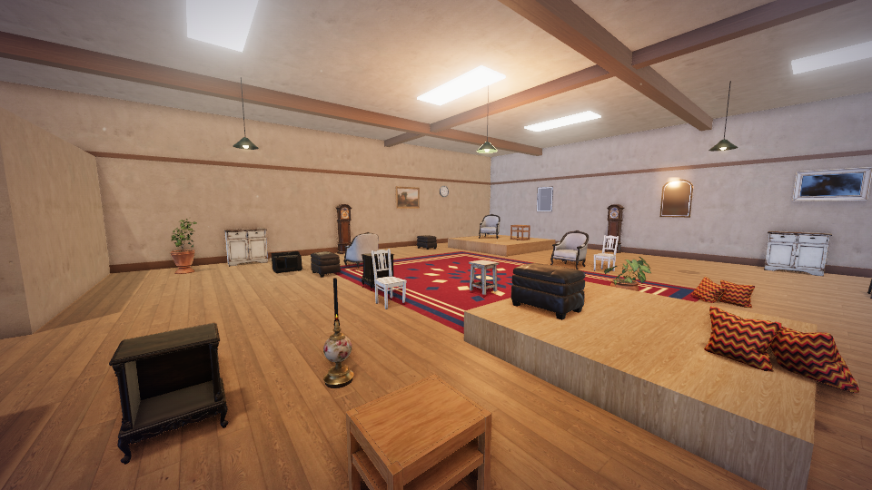
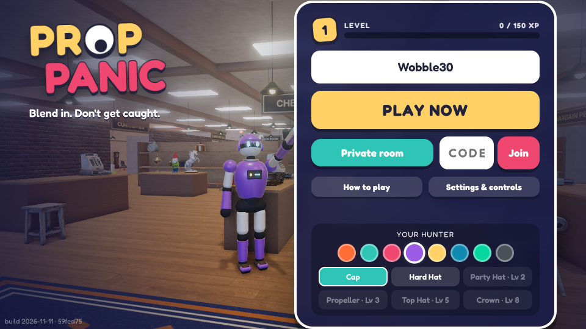
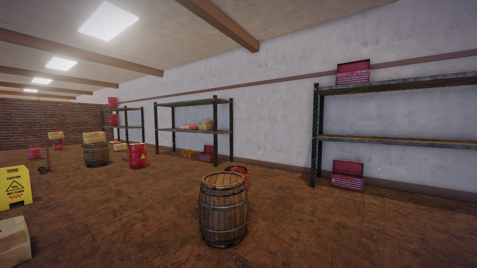
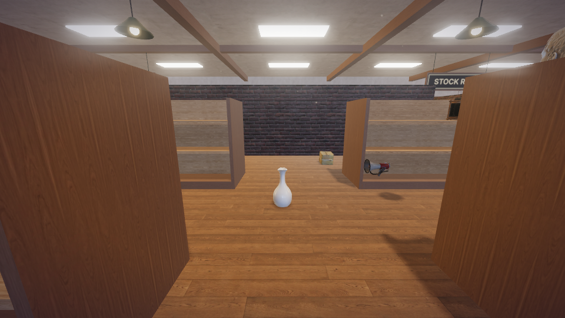
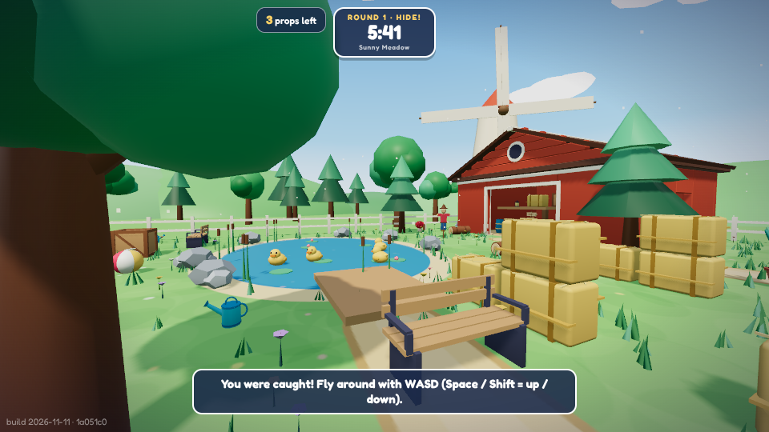

# PROP PANIC

**Blend in. Don't get caught.** A browser multiplayer prop-hunt party game.

Props disguise themselves as everyday objects and hide in plain sight. Hunters have a few minutes to zap
every fake. It runs in any desktop browser with no install. The objects are photo-scanned, physically based
models lit by HDR panoramas (about 25 MB, streamed in after the menu appears); all sound and music is synthesised in code
(no audio files), with a composed, adaptive soundtrack.



| | |
| --- | --- |
|  |  |

## Maps

| Tumbleton's Emporium | Sunny Meadow |
| --- | --- |
| Indoors, dense and vertical: shelving aisles, a furniture hall, a curiosities gallery, a stock room, a climbable crate fort and a bargain pen. | Outdoors and open: long sight lines, a barn with a loft, pond, campsite, market, kitchen garden, barrel yard and play fort. |
|  |  |

Maps alternate every round (the host of a private room can lock one). Each has its own disguises, 66 in total, and
its loose props are re-laid out from a new seed every round. Blackout becomes an eclipse outdoors.



## What makes it different from plain Prop Hunt

| Mechanic | What it does |
| --- | --- |
| **Focus, then QUACK** | Every innocent object a hunter shoots drains Focus. At zero, the hunter spends 6 seconds as a helpless rubber duck. Spray-and-pray is punished with public humiliation. |
| **Scanner pulse (hunter, Q)** | An expanding ring that only detects props that *move* while it passes. Props see it coming and get a "FREEZE!" warning. |
| **Shockwave (hunter, F)** | Launches real props near the hunter into the air. Innocent objects never flinch. |
| **Decoys (prop, Q)** | Leaves a twitching copy of your disguise. A hunter who shoots it is flash-blinded and loses Focus. Decoys also squeak during roll calls. |
| **Panic burst** | A prop that gets hit is not dead: it gets a short speed boost and one chance to escape. Three hits to catch. |
| **Head bonk** | A prop that drops onto a hunter's head leaves them dizzy and unable to fire for a moment, and bounces away. |
| **Googly eyes** | Whenever a prop taunts, panics, sneezes or is scanned, a pair of googly eyes pops out of it. |
| **Last prop standing** | The final survivor gets Vanish and Decoy recharged; hunters get faster roll calls. |
| **Great escape** | Survive six seconds after being hit and you bank bonus points. |
| **Vanish (prop, F) / Dash (Shift)** | Three seconds of invisibility to hunters; a short sprint. |
| **Caught? Haunt the round** | A caught prop (or a late joiner sitting a round out) becomes a ghost. Aim at any real object and click to **haunt** it: it hops and twists like a nervous prop. A hunter who shoots it within 9 s is *spooked* (extra Focus loss) and the ghost scores. Right click (or Q / F) hops between players, Space looks through a hunter's eyes, a direction key flies free through walls. Caught bots haunt too. |
| **Study the room (hunters)** | While the props hide, hunters fly a camera round the room as it was stocked, with no props in it, instead of staring at a blindfold. Anything that turns up later is a fake. |
| **Hunter stand-in** | A hunter who drops out for 12 s, or idles for 45 s in a public room, hands the blaster to a bot instead of handing the props a free round. |
| **Risky taunts (T or 1-5)** | Taunting scores more the closer a hunter is, and shortens ability cooldowns. |
| **Chaos meter** | Missed shots, taunts and popped decoys fill it. When full: **Blackout**, **Poltergeist** (objects start hopping), **Prop Shuffle** (everyone becomes a different toy), **Moon Bounce** (low gravity) or **Achoo** (every real prop sneezes into the air). |
| **Roll call** | Every 22 s all props squeak, positioned in 3D audio. |
| **PANIC TIME** | Final 30 s: props squeak every 7 s but move faster. |
| **Restocked every round** | Each map's ~240 loose props are laid out from a new seed each round. |

Roles rotate automatically and the next round starts by itself. Rounds are 25 s hiding + 3 min hunting. Each round opens with
a role card (which side you are on and the one thing to do), counts 3 · 2 · 1 before the hunters are let loose, and closes
with a three-second reveal in which a pillar of light marks every prop that got away before the board comes up.

## Run it

```bash
npm install
npm run dev        # server on :8080 + Vite client on http://localhost:5173
```

Production (one process serves the client and hosts every room):

```bash
npm run build
npm start          # http://localhost:8080
```

Or with Docker: `docker build -t prop-panic . && docker run -p 8080:8080 prop-panic`.
Any host that runs a Node container and allows WebSockets works. Set `PORT` if needed.

## Playing with friends

- **Play now** drops you into a public room. Empty seats are filled with clearly labelled bots, and
  humans replace them as they join. You can join mid-round.
- **Create private room** gives a 4-letter code and an invite link (`?room=CODE`). The host can add
  bots, picks the game length and starts the game.
- **A game is a set of rounds**, three by default. Scores run across the game, the hunter role rotates each
  round, and the last round ends with the final standings before everyone returns to the lobby. Public games
  are always three rounds; the host of a private room can pick 1, 3, 5, 7 or 10.
- Refreshing the page or a short network drop puts you back in your seat.

## Game modes and what is coming

The Play card has a **Game mode** row. **Classic** is the game described above and the only live mode. The others
sit beside it as boxed games with a swinging *SOON* price tag; tapping one shows what it is, with a link to its box.
The **Coming soon** tab in the menu (NEW badge until opened) is the stock room: a staff notice, and a shelf of boxed
modes with hand-drawn box art (SVG, in `client/src/soon.ts`) and a *Coming soon* label clipped to the shelf. Opening a
box shows how the mode plays, how many players it suits and why it is different; arrows (or ← →) flip through them.

| Mode | Players | The idea |
| --- | --- | --- |
| **Turncoat** | 4–12 | Caught props join the hunters; the last prop faces the whole shop. |
| **Paranoia** | 3–8 | Free-for-all: every player is an object with a blaster. |
| **Clearance** | 4–12 | One object everywhere; hunters go on behaviour alone. |
| **Priceless** | 5–12 | One prop is the Heirloom; the rest guard it. |
| **Five-Finger Discount** | 4–10 | Props smuggle gold-tagged stock to the till, so they have to move. |
| **Stopwatch** | 2–4 | Take turns hiding; the faster finder wins. Made for two. |

Each was chosen because it changes what a player decides during a round (not just its length), builds on systems the
game already has, and works with a small group. None has a date. **Want it** is kept in the player's browser
(`pp_wants`) and not sent anywhere yet, so no counts are shown. When a mode ships, move it out of `MODES`, and bump
`SOON_VERSION` whenever the list changes so the NEW badge comes back. The private-room lobby lists the same modes.

## Progression

Click the price tag on the menu card to open your profile. Everything a round earns is listed on the results panel.

| Part | What it is |
| --- | --- |
| **Level and price tag** | Every point you score is XP. Each level pays coins, and every few levels your price tag gets a new name: Bargain Bin, Knick-Knack, Curio, Collectible, Antique, Heirloom, Priceless. Your level shows next to your name in the lobby, on the scoreboard and on the results. |
| **Characters** | Nine hunters to play as, from the Night Guard and the original Securibot to Granny Tumbleton, Mall Santa and Barnaby Bear. Same skeleton, size and hit box for all: a character is only a look. |
| **Hunter locker** | Blasters you can see in your hand (13, from the Zapper to a Banana, a Wet Fish and Finger Guns), zap trails, hats and paint. Every blaster fires the same shot. |
| **Prop wardrobe** | Googly-eye styles, and the burst everyone sees when you are caught. None of them can give a hiding prop away: the eyes only come out when a prop has already given itself away (a taunt, a panic, the scanner), and the burst comes when there is nothing left to hide. |
| **Catalogue** | Every one of the 66 disguises has two stamps: **Hid** (survive a round disguised as it, and have worn it for the last 20 seconds) and **Caught** (catch a prop disguised as it). Stamps turn silver at 3 and gold at 10; every new grade pays XP and coins. Objects are filed in five departments of the Emporium; hiding as everything in one earns that department's look. |
| **Feats** | 24 milestones (50 catches, 20 great escapes, every catalogue stamp, turned into a duck 10 times...). Each pays out once and unlocks its name as a **title** worn next to yours. |
| **Odd jobs** | Three small goals a day, the same for everyone (one as a prop, one as a hunter, one either way). Each pays coins and XP; all three pay a bonus. |

Why it is built this way: the Catalogue only pays for surviving as something *new*, which nudges players away from always
hiding as the same handful of best objects, and that keeps hunting fresh. Coins come from playing well, not from
playing long: the server pays at most 50 coins a round (95 on the last round of a game).

### Earning coins

The server works out what each round pays (`COINS` in `shared/constants.ts`) and sends it with the results:

| When | Coins |
| --- | --- |
| Each round, for taking part | 5 |
| Each round, per 20 points scored | +1 (round total capped at 40) |
| Each round, on the winning side | +10 |
| Last round, for finishing the game | +15 |
| Last round, 1st / 2nd / 3rd in the game | +30 / +20 / +10 (last place never gets one) |

On top of that, from the profile rules (`shared/progress.ts`): each level pays 20 + 5 per level (up to 150), a new
catalogue stamp 5 (silver 10, gold 25), an odd job 40-80, all three jobs 75 more, and some feats 50-500. Prices in
the wardrobe run from 150 to 1,200, blasters and trails from 250 to 2,500, and characters from 800 to 4,000.

### Where the profile lives

In the browser, as one record (`pp_profile`), because there are no accounts. **Overview → Backup** copies a save code
that restores it in another browser. A 2.6 profile (XP, coins and look) is carried over on first load; a player who
had the Crown keeps it, though it now unlocks at level 20.

Anyone can edit their own profile with the browser's developer tools. The server only checks that what a player
wears is a valid item, not that they own it (`SECURITY.md`). Nothing is sold for money and every look is cosmetic,
so that is an acceptable trade until there are accounts. All the rules are pure functions in `shared/progress.ts`,
so they can move to the server behind a login without a rewrite.

## Controls

Every key can be rebound under **Settings & controls** (main menu, or `Esc` in game), alongside mouse
sensitivity, invert-Y, field of view, sound and music volume, and graphics quality. Defaults:

`WASD` move · `Space` jump · mouse look · `Click`/`E` become an object (prop) or fire (hunter) · `Q` `F` abilities ·
`Shift` dash · `T` / `1-5` taunt · right-click holds a prop's rotation or zooms a hunter's aim · scroll zooms ·
`H` controls card · `Enter` quick chat · `Tab` scores · `M` mute.

New players get a "How to play" guide on first visit, an objective line at the top of the screen and
a controls card for their current role.


## Deploying

`render.yaml` is a Render blueprint (free plan, Docker). The menu shows a build stamp in the bottom-left
corner (date and commit), so you can check which version a server is actually running.

The server needs no configuration on Render.

### How many people can play at once (the alpha front door)

A free Render instance has a tenth of a CPU, so the server has `PP_SEATS` seats (default 24). While a seat is free,
Play gets you in: quick play fills public tables of 8, so 24 players sit at exactly 3 tables. Once all 24 are taken,
Play says GET IN LINE and shows an estimated wait; pressing it gives a place in a fair line with a live position and
estimate, and a practice game against bots in your own browser while you wait. When a seat frees you are called in.
Nobody already playing is ever removed. Private rooms have their own small limit (`PP_PRIVATE_TABLES`, default 3),
because one person can fill one with bots. The Play page shows the tables live (`GET /status`). Details: `server/gate.ts`.

The estimated wait is the measured rate at which seats have freed up over the last 20 minutes; until there is enough
history, it is the time until the next round ends at any table plus one round-gap per place ahead in line.

What the defaults are based on (measured on the server process, real snapshots, rounds in the hunt phase):

| Load | CPU (cores) | Sent to each player |
| --- | --- | --- |
| 24 humans at 3 full public tables | ~0.07 | ~7 KB/s |
| 16 private rooms, each 1 human + 7 bots | ~0.11 | ~5 KB/s |

Bots cost more CPU than humans, which is why private rooms are limited as well as seats. A free instance's CPU is likely
slower than the machine these were measured on, so watch `/admin` and `/status` (`hot: true` means the load brake is
on) before raising the limits. Bandwidth matters too: one player for an hour is roughly 25 MB, so check your plan's
monthly allowance. Elsewhere, see `SECURITY.md` for the variables that matter
behind a proxy (`PP_TRUST_PROXY`), on a second domain (`PP_ORIGINS`) or inside a portal's frame
(`PP_FRAME_ANCESTORS`).

### Lag and hosting

Every room runs in the one server process, so they all share its CPU. Render's free plan gives that process a
tenth of a CPU. Once it has used its share of a 100 ms period, the kernel freezes it for the rest of that period,
and every player in every room waits: pings jump by up to ~90 ms and movement stutters. `npm run test:load` with
`LOAD_CPU=0.1` reproduces this: with 4 rooms of 8 players, stalls already add 40-125 ms to the slowest 5% of pings.
The seat limit above keeps a free instance below that point. To raise `PP_SEATS`, move to a plan with more CPU
(Starter is half a CPU, five times the headroom), then check the new limit with `npm run test:load`.

`/health` reports `tick.avg` / `tick.p99` (ms per room tick) and `tick.lag` (99th percentile event-loop delay, ms).
Open it while a game feels laggy. A `lag` of tens of milliseconds means the server is starved for CPU. If it stays
around 10 ms or less, the lag is the network (distance to the server's region) or the player's device (the in-game
connection badge says when a low frame rate is the cause).

The server's region also sets the lowest ping anyone can get. Render puts a service in Oregon unless the blueprint
says otherwise, and the region cannot be changed once a service exists (a new service is needed). Pick the one
nearest your players.

## Admin page and statistics

Set `PP_ADMIN_KEY` and open `/admin` (any user name, the key as the password) to see who is online, the rooms open,
and, with a free Supabase project behind it, the history: different players per day, visits and how long they last,
rounds, peak online, and hunter / prop win rates per map. No names or addresses are stored. Setup, including the SQL to
paste into Supabase: `docs/ADMIN.md`.

## How it is built

```
shared/   deterministic map generator, AABB character physics, prop catalog, protocol, progression rules
server/   Node + ws: rooms, matchmaking, round flow, hit detection, abilities, bots
client/   Three.js + Vite: rendering, prediction, HUD, synthesised audio
test/     protocol test (WebSocket clients) and browser test (two Chromium clients)
```

- **Server-authoritative.** Clients send inputs and intents only. Roles, movement, hits, cooldowns,
  timers, scores and results are decided on the server. The same physics code runs on both sides, so
  the client predicts its own movement and is corrected by the server.
- **Anti-cheat.** A per-player time bank stops speed hacks; fire rate, transform range and cooldowns
  are validated; shots are lag-compensated on the server. Hunters are only sent props they have line of
  sight to, and never what a hidden prop is disguised as, so a modified client cannot see through walls.
  What that does not stop is listed in `SECURITY.md`.
- **Hardened server.** Guarded handlers, payload and rate limits, per-address connection limits, origin
  checks, heartbeats, back-pressure handling, unguessable seat tokens and a strict content security
  policy. `SECURITY.md` has the threat model.
- **Assets.** Models, textures and HDR panoramas are CC0 from Poly Haven (`CREDITS.md`), fetched and
  optimised by `tools/assets.mjs`. They stream in behind plain placeholders, so the game is playable
  before they arrive and survives a failed download. Hunters, trees, grass and water are generated in
  code; every sound and all music is synthesised with WebAudio.
- **Sound.** No audio files. Instruments are physical and studio models (plucked strings, struck bars, FM piano,
  filtered saws, a drum kit) rendered into sample buffers in the background (`client/src/sound/dsp.ts`); the four songs
  are written out note by note in a compact notation (`client/src/sound/songs.ts`). The hunt music adds layers as
  tension rises. `npm run audio:render` writes every track and effect to audio files to listen to.
- **Rendering.** Image-based lighting from HDR panoramas, physically based materials with normal,
  roughness and occlusion maps, soft shadows, bloom and filmic tone mapping. Three tiers: Ultra adds
  screen-space ambient occlusion and 4K shadows; High is the default on integrated graphics; Fast drops
  shadows, grass and post-processing. The game steps down a tier by itself if the frame rate is poor.

## Tests

```bash
npm test             # protocol: rooms, roles, movement authority, speed-hack clamp, shooting, reconnect
npm run build && npm run test:e2e   # two real browsers play a full round against each other
npm run build && npm run test:ghost # a late joiner haunts a round of bots, with mouse and keyboard and with touch
npm run test:maps        # both maps: deterministic, free spawns, bot-navigable, sane prop counts
npm run test:mechanics   # bonk, escape bonus, sneeze, last-prop showdown, checked directly on the server
npm run test:audio       # every instrument, effect and song renders clean (finite, unclipped, no DC offset)
npm run test:progress    # levels, catalogue, feats, odd jobs, wardrobe, banking a round, save codes
npm run test:stats       # admin page password and lockout, statistics written to (a stand-in for) Supabase
npm run test:security    # attacks a real server: crashes, floods, traversal, hijacking, what hunters are sent
npm run test:soak    # bots play many fast rounds with chaos events turned up; fails on any server error
npm run test:gate        # the line: seats and tables run out, passes, reconnects skip the line, private codes stay secret
npm run build && npm run test:lineup # in a browser: the table board, the line, practice while waiting, the call to take the seat
npm run test:load    # rooms full of browser-like clients: ping, snapshot rate and size, server CPU (LOAD_CPU=0.1 = Render free)
```

`PP_FAST=1` shortens every phase for testing (`PP_HIDE_MS`, `PP_HUNT_MS`, `PP_END_MS`, `PP_FINAL_MS` override them).

CI (`.github/workflows/ci.yml`) runs the typecheck, build, audio, map, progression, mechanics, security, statistics, line and protocol tests on every push.

## Tuning

All gameplay numbers (speeds, damage, cooldowns, chaos rates, phase lengths, every score in `SCORE`, the odds of each
chaos event in `CHAOS_WEIGHTS`) live in `shared/constants.ts`. The 2.5 systems each have a switch there: `HAUNT_ON`,
`PREVIEW_ON`, and the stand-in timers `HUNTER_DC_MS` / `HUNTER_AFK_MS`. The game has been played by groups of up to 8
people; `docs/PLAYTEST.md` is the checklist for watching a session, and the admin page's win rates per map show which way
real rounds are leaning.
